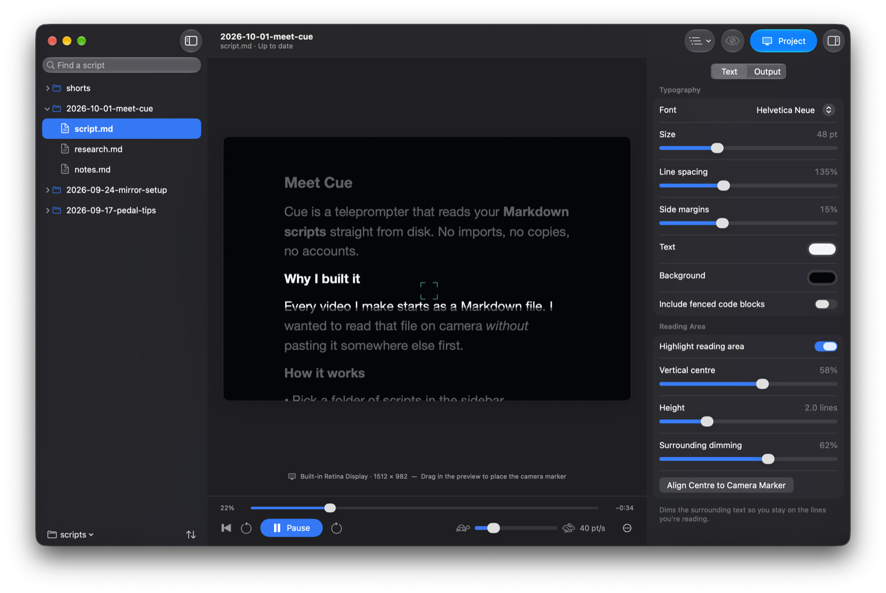
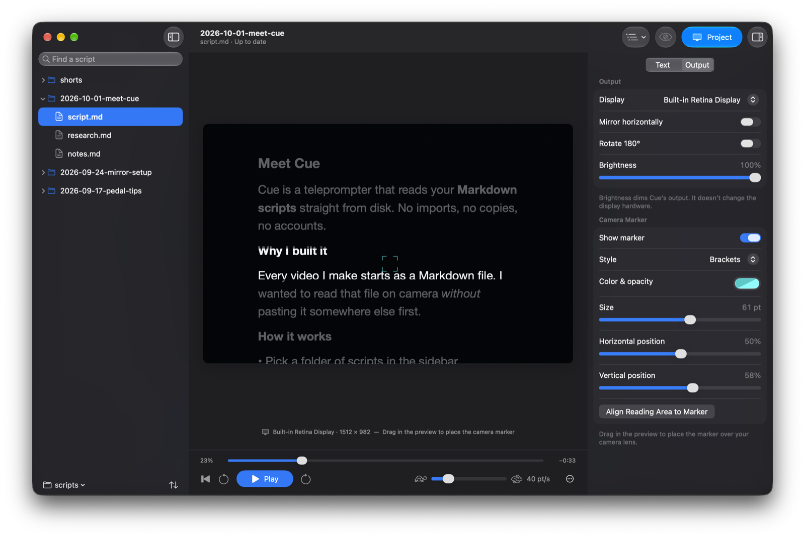
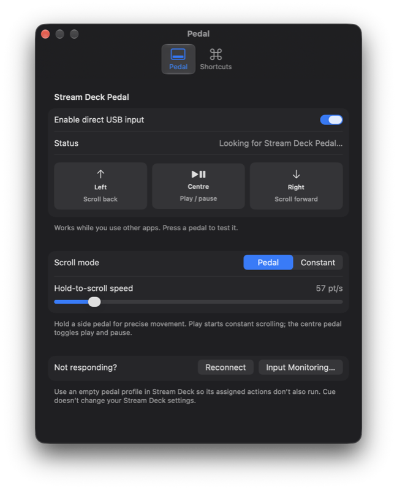

# Cue

**A native macOS teleprompter for the Markdown scripts you already have.**

Point Cue at a folder of `.md` files, pick a script, and read it on your prompter display. Cue reads your files in place, reloads them live as you edit, and works with an Elgato Stream Deck Pedal for hands-free scrolling. It's built entirely with SwiftUI, AppKit, TextKit and IOKit: no web view, no Electron, no account, no server.



## Features

- **Your files, untouched.** Browse a folder of Markdown scripts in a searchable, sortable sidebar. Cue never copies, imports or writes to them.
- **Live reload.** Save in any editor and Cue picks up the change within a second, keeping your place.
- **Spoken-script rendering.** Headings, paragraphs, lists, emphasis and quotes appear without Markdown symbols. Frontmatter, comments, images and code blocks are hidden.
- **Prompter output.** Project to any display (Elgato prompters are picked automatically), mirror or rotate for beam-splitter glass, and dim the output.
- **Reading area and camera marker.** Highlight the lines you're reading, dim the rest, and line both up with a marker placed over your camera lens.
- **Stream Deck Pedal.** Hold the side pedals to scroll and tap the centre to play or pause, even while another app has focus.
- **Global shortcuts.** Play, project, black out and rewind from any app.

## Requirements

- macOS 14 Sonoma or later, on Apple silicon or Intel. Cue adopts the current system design on newer releases.
- To build from source: Xcode 26 or later, or its Command Line Tools (for the macOS 26 SDK).
- Optional: an Elgato Prompter (or any second display) and an Elgato Stream Deck Pedal.

## Install

### Download

Get the latest **Cue-x.y.z.dmg** from [Releases](https://github.com/jolbol1/cue/releases/latest), open it, and drag **Cue** onto **Applications**.

Releases aren't notarized yet, so macOS blocks Cue the first time you open it. Open **System Settings → Privacy & Security**, scroll down and click **Open Anyway**. Alternatively, run `xattr -dr com.apple.quarantine /Applications/Cue.app`. After updating, you may need to turn Cue's **Input Monitoring** permission off and on again for the pedal.

### Build from source

```sh
git clone https://github.com/jolbol1/cue.git
cd cue
./scripts/build.sh
open dist/Cue.app
```

The build produces `dist/Cue.app`, which you can move to `/Applications`. It's ad-hoc signed for your Mac. Keep the app in one place after granting macOS permissions, because rebuilding or moving it can require granting them again.

## Getting started

1. **Choose your scripts folder** from the folder menu at the bottom of the sidebar, or with **File → Choose Scripts Folder…** (⇧⌘O). You can also open a single file with ⌘O or from Finder.
2. **Select a script.** The preview shows exactly what your prompter will display.
3. **Set up the output** in the inspector's **Output** tab: choose the prompter display, then turn on mirroring or rotation if your rig needs it.
4. **Place the camera marker** by dragging in the preview, then use **Align Reading Area to Marker** so the lines you read sit next to the lens.
5. Click **Project**, then press **Play** (or tap the centre pedal).



## Using Cue

### Scripts

The sidebar shows every `.md` and `.markdown` file under your scripts folder as a folder tree. Only folders containing Markdown files appear.

- **Search** with the field at the top (⌘F). Matches keep their folder context, and clearing the search restores your expanded folders.
- **Sort** with the button at the bottom: by name, date modified or date created, ascending or descending. Folders always stay above files, and the order is remembered.
- **Refresh** (⌘R) to pick up newly created files.
- **Right-click** a file or folder to show it in Finder or open it in your default editor.

The open script is checked every second, including atomic saves from editors. Reloads keep your proportional position in the script. If the file disappears or becomes unreadable, the last readable version stays on screen and the window subtitle explains what happened.

### Text and reading area

The inspector's **Text** tab sets the font, size, line spacing, side margins and colours. It also controls the **reading area**: a highlighted band, 1 to 5 lines tall, that dims the text around it so your eye stays on the current line. Changing its height keeps it centred, and turning it off removes the dimming without moving the text.

### Output and camera marker

**Project** opens a borderless window on the chosen display. It never takes keyboard focus or mouse input, so you can keep working on your other screens, and it stays visible across Spaces and full-screen apps. While you're live, the button turns into **Stop**, the preview shows a **LIVE** badge, and the blackout toggle in the toolbar hides the script without ending projection.

The camera marker (crosshair, brackets, dot or reading line) stays in physical screen coordinates even when the text is mirrored or rotated. Output brightness is software dimming; Cue doesn't change your display's hardware settings.

Projection stops automatically if the display disconnects or you close Cue's window. Cue keeps running in the menu bar.

### Playback

The bar under the preview has back-to-start, back and forward (three lines at a time), play and pause, and a speed slider in points per second. The **…** menu sets an optional 3- or 5-second count-in and looping. The time next to the scrubber estimates how long is left at the current speed.

To jump around, drag the scrubber, scroll over the preview, or pick a heading from the **Sections** menu in the toolbar.

### Stream Deck Pedal



Turn on **Enable direct USB input** in **Cue → Settings… → Pedal** (⌘,). Cue reads the pedal directly over USB (vendor `0x0fd9`, product `0x0086`). It doesn't send keystrokes, so it works while any app has focus:

| Pedal | Action |
|---|---|
| Hold left | Scroll back |
| Tap centre | Play / pause (respects the count-in) |
| Hold right | Scroll forward |

Releasing a side pedal stops its movement, and playback resumes if it was running. The indicators in Settings light up as you press each pedal, which makes it easy to test. Hold-to-scroll speed is set separately from playback speed.

Cue shares the USB connection with the Stream Deck app and never changes your Stream Deck configuration. **Assign the pedal an empty profile in the Stream Deck app** so its own actions don't also fire. If macOS blocks USB input, allow Cue under **System Settings → Privacy & Security → Input Monitoring**, then click **Reconnect**.

### Keyboard shortcuts

These work from any app, so you don't have to switch back to Cue mid-take:

| Action | Shortcut |
|---|---|
| Play / pause | ⌃⌥⌘Space |
| Project / stop projecting | ⌃⌥⌘P |
| Blackout / show script | ⌃⌥⌘B |
| Back to start | ⌃⌥⌘R |
| Stop projecting | Esc, with the pointer over the output display |

Escape is only claimed while your pointer is over the live output, so it keeps working normally everywhere else. These are registered hotkeys rather than a keyboard monitor, so they need no Accessibility permission. They're also listed in **Settings → Shortcuts** and the **Playback** menu, and the menu bar icon offers play, projection and blackout controls.

## Markdown support

Cue renders scripts for reading aloud, not as a full CommonMark viewer:

- **Shown:** headings, paragraphs, lists (numbered and task-list items show as bullets), quotes, bold, italic and inline code, all without their Markdown symbols.
- **Hidden:** YAML frontmatter, HTML comments, standalone images, link reference definitions and horizontal rules. Fenced code blocks are hidden unless you turn on **Include fenced code blocks** in the Text tab.
- **Not fully supported:** tables, embedded HTML and reference-style links.

Cue keeps its settings, the last opened file and the window layout in macOS user defaults, and stores nothing else.

## Development

```
Sources/
  PrompterCore/        Markdown parsing, file tree, scrolling and reading-band maths
  MarkdownPrompter/    The app: SwiftUI views, prompter canvas, output window, pedal and hotkeys
Tests/PrompterCoreTests/   CueChecks, a dependency-free test runner
scripts/               build.sh and test.sh
```

Run the core checks (no Xcode or XCTest needed):

```sh
./scripts/test.sh
```

They cover the folder tree, search and sorting, Markdown filtering, incomplete fences, Windows line endings, pedal report decoding, time-based scrolling and looping, and reading-area alignment.

`scripts/build.sh` stamps the installed SDK version into the binary with `vtool`. Without it, SwiftPM records the macOS 14 deployment target as the SDK, and newer macOS releases run the app in compatibility mode with the older design. It also accepts `CUE_UNIVERSAL=1` (Apple silicon + Intel), `CUE_VERSION` and `CUE_BUILD` for release-style builds.

### Releases

[`.github/workflows/release.yml`](.github/workflows/release.yml) publishes a release automatically whenever a push to `main` changes the app (`Sources/`, `Resources/`, `Package.swift` or `scripts/build.sh`). It runs the checks, builds a universal app on a macOS 26 runner, packages it as a drag-to-Applications DMG with `scripts/package.sh` (which uses [dmgbuild](https://github.com/dmgbuild/dmgbuild)), and publishes it with release notes generated from the commits.

- **Version numbers** bump the patch by default (1.0.0 → 1.0.1).
- **Bigger bumps:** put `#minor` or `#major` anywhere in a commit message.
- **Manual releases:** run the workflow from the Actions tab and choose the bump.

#### Signing and notarization

When these repository secrets are set, the workflow signs Cue with a Developer ID (hardened runtime) and has Apple notarize and staple the DMG. Without them, releases are ad-hoc signed.

| Secret | Value |
|---|---|
| `DEVELOPER_ID_P12_BASE64` | Your **Developer ID Application** certificate and private key, exported from Keychain Access as a `.p12`, then base64-encoded |
| `DEVELOPER_ID_P12_PASSWORD` | The password you set when exporting the `.p12` |
| `NOTARY_KEY_P8` | The contents of an App Store Connect API key file (`AuthKey_XXXXXXXXXX.p8`) |
| `NOTARY_KEY_ID` | That API key's ID |
| `NOTARY_ISSUER_ID` | The issuer ID shown above the list of App Store Connect API keys |

## Acknowledgements

- [Apple: IOHIDManager input callbacks](https://developer.apple.com/documentation/iokit/1438367-iohidmanagerregisterinputvalueca)
- [python-elgato-streamdeck](https://github.com/abcminiuser/python-elgato-streamdeck/blob/master/src/StreamDeck/Devices/StreamDeckPedal.py), for the Stream Deck Pedal report layout
